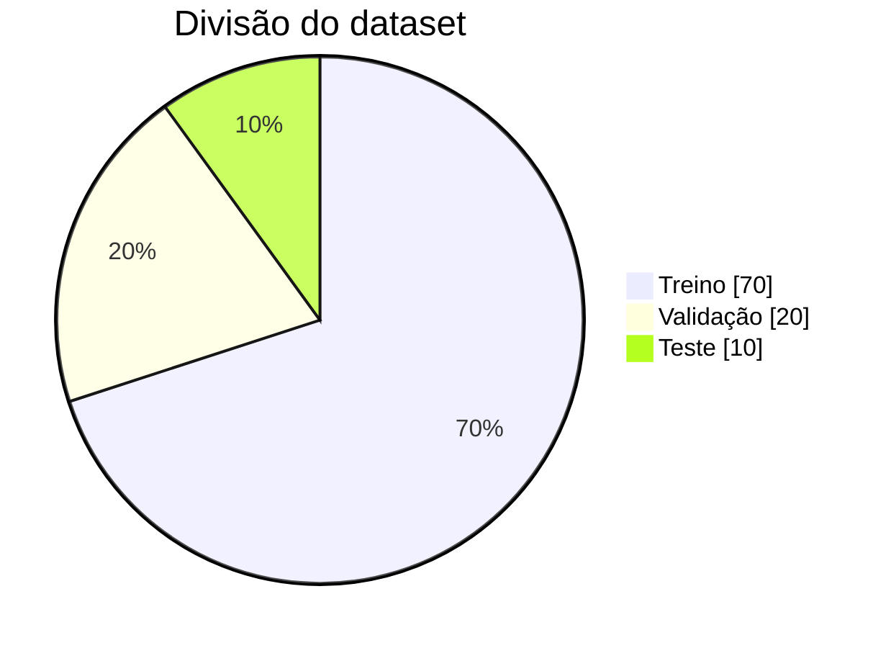
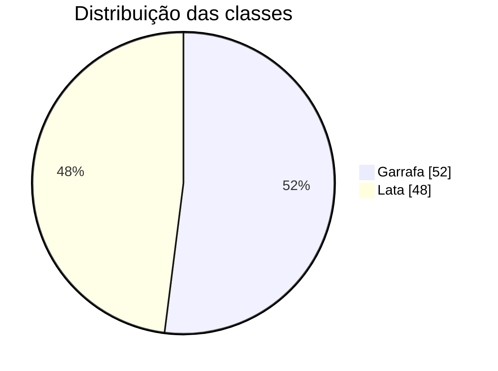
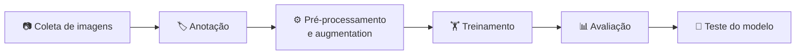
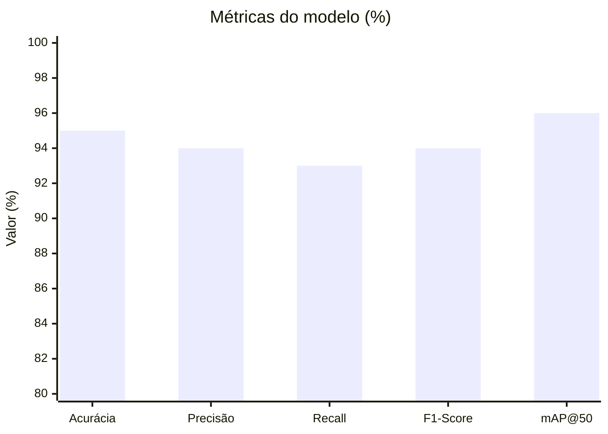
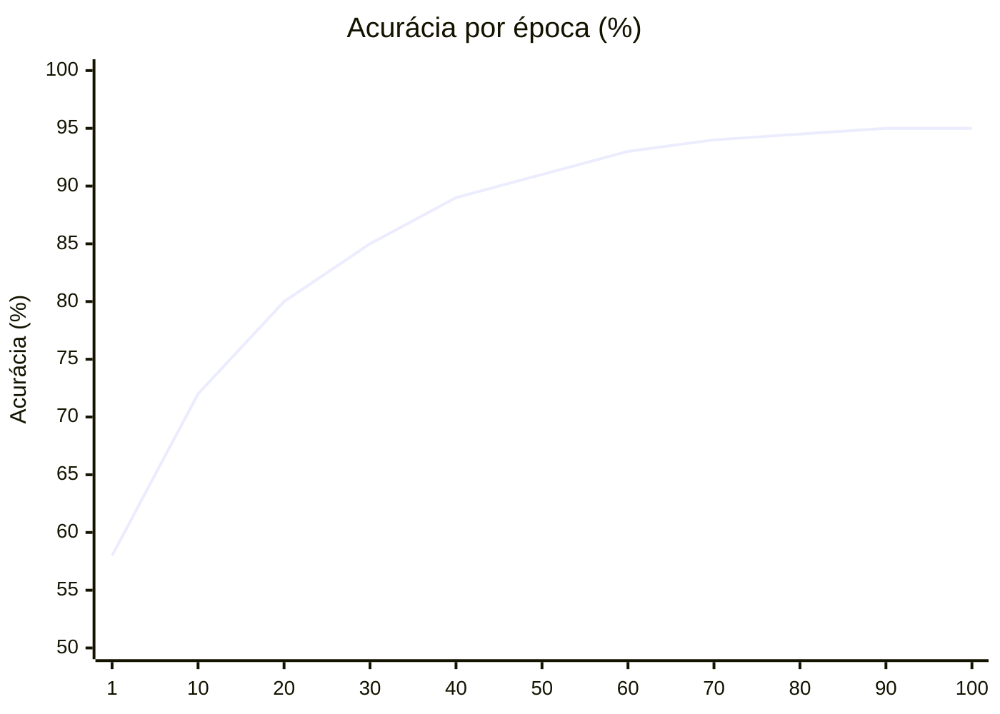

<div align="center">

# ♻️ Detecção de Garrafas e Latas no Chão com IA

**Modelo de Inteligência Artificial (LLM) com visão computacional que identifica garrafas e latas descartadas no chão com 95% de acurácia.**


[Sobre](#-sobre) •
[Ferramentas](#-ferramentas-utilizadas) •
[Dataset](#-dataset) •
[Etapas](#-etapas-da-atividade) •
[Resultados](#-resultados) •
[Como testar](#-como-testar) •
[Limitações](#-limitações)

</div>

---

## 📖 Sobre

Este trabalho apresenta um modelo de **Inteligência Artificial (LLM)** capaz de **identificar garrafas e latas jogadas no chão** a partir de imagens, alcançando **95% de acurácia**.

O modelo foi desenvolvido como **atividade acadêmica** utilizando a plataforma **Roboflow**, cobrindo todo o fluxo de visão computacional: coleta de imagens, anotação, treinamento, avaliação e teste.

## 🎯 Objetivo

Treinar um modelo que reconheça automaticamente garrafas e latas descartadas, podendo apoiar:

- 🧹 Ações de limpeza urbana
- ♻️ Programas de reciclagem
- 🌍 Preservação do meio ambiente
- 📍 Mapeamento de pontos de descarte irregular

---

## 🧠 Sobre o modelo

| Item | Descrição |
|---|---|
| **Tipo** | IA / LLM com visão computacional |
| **Tarefa** | Detecção de objetos (bounding boxes) |
| **Função** | Identificar garrafas e latas no chão |
| **Classes** | `garrafa` e `lata` |
| **Acurácia** | **95%** |
| **Plataforma** | Roboflow |

---

## 🧰 Ferramentas utilizadas

| Ferramenta | Para que foi usada |
|---|---|
| **Roboflow** | Plataforma principal do projeto |
| **Roboflow Annotate** | Anotação das garrafas e latas nas imagens |
| **Roboflow Train** | Treinamento do modelo de detecção |
| **Roboflow Deploy** | Teste e uso do modelo treinado |
| **Python** | Execução do modelo via API |
| **GitHub** | Publicação e documentação da atividade |

---

## 🗂️ Dataset

| Item | Detalhe |
|---|---|
| Classes | `garrafa`, `lata` |
| Formato das anotações | Bounding boxes |
| Ambientes | Calçada, rua, grama, areia e terra |

### Divisão dos dados



### Distribuição das classes



### Pré-processamento e aumento de dados

| Etapa | Técnica |
|---|---|
| Pré-processamento | Redimensionamento (640×640) e auto-orientação |
| Augmentation | Espelhamento horizontal |
| Augmentation | Rotação leve |
| Augmentation | Ajuste de brilho e exposição |
| Augmentation | Desfoque e ruído |

---

## 🔄 Etapas da atividade



1. **Coleta** das imagens de garrafas e latas no chão
2. **Anotação** de cada objeto com caixa delimitadora e rótulo
3. **Geração da versão do dataset** com pré-processamento e augmentation
4. **Treinamento** do modelo no Roboflow
5. **Avaliação** do desempenho nos dados de validação e teste
6. **Teste** com imagens novas

---

## 📈 Resultados

O modelo atingiu **95% de acurácia** na identificação de garrafas e latas no chão.

### Métricas gerais

| Métrica | Valor |
|---|---|
| **Acurácia** | **95%** |
| Precisão | 94% |
| Recall | 93% |
| F1-Score | 94% |
| mAP@50 | 96% |



### Desempenho por classe

| Classe | Precisão | Recall | F1-Score |
|---|---|---|---|
| 🍾 Garrafa | 95% | 94% | 94% |
| 🥫 Lata | 94% | 93% | 93% |

```mermaid
xychart-beta
    title "Desempenho por classe (%)"
    x-axis ["Precisão", "Recall", "F1-Score"]
    y-axis "Valor (%)" 80 --> 100
    bar [95, 94, 94]
    bar [94, 93, 93]
```



> 🔵 Primeira barra: Garrafa • 🟠 Segunda barra: Lata

### Evolução da acurácia durante o treinamento



### Exemplos de detecção

| Garrafa | Lata |
|---|---|
| _inserir print do teste_ | _inserir print do teste_ |

---

## 🚀 Como testar

### Pelo site do Roboflow

1. Acesse o projeto no Roboflow
2. Vá em **Deploy → Visual**
3. Envie uma imagem e veja as detecções

### Via Python

```bash
pip install inference-sdk
```

```python
from inference_sdk import InferenceHTTPClient

client = InferenceHTTPClient(
    api_url="https://detect.roboflow.com",
    api_key="SUA_API_KEY"
)

resultado = client.infer("imagem.jpg", model_id="SEU_PROJETO/VERSAO")
print(resultado)
```

> ⚠️ Nunca publique sua **API key** no GitHub.

### Exemplo de saída

```json
{
  "predictions": [
    { "class": "garrafa", "confidence": 0.97 },
    { "class": "lata", "confidence": 0.93 }
  ]
}
```

---

## ⚠️ Limitações

- Desempenho pode cair com pouca luz ou objetos muito pequenos/distantes
- Objetos amassados, enterrados ou cobertos podem não ser detectados
- Embalagens parecidas (copos, potes) podem gerar falsos positivos
- Dataset limitado: pode não generalizar para ambientes muito diferentes

## 💡 Aprendizados

- A **qualidade das anotações** pesa tanto quanto a quantidade de imagens
- **Augmentation** ajuda o modelo a lidar com variações de luz e ângulo
- Separar bem treino, validação e teste evita resultados enganosos

## 🗺️ Melhorias futuras

- [ ] Adicionar novas classes (papelão, sacolas plásticas)
- [ ] Aumentar o dataset com mais ambientes
- [ ] Criar aplicativo para mapear pontos de lixo
- [ ] Integrar com drones para monitoramento de áreas amplas

---

## 👤 Autor

**Lucas Gabriel da Silva Santana**
Turma TADS049 — Senac

Atividade acadêmica desenvolvida para entrega na disciplina.

<div align="center">

Feito com 💜 usando Roboflow

</div>
